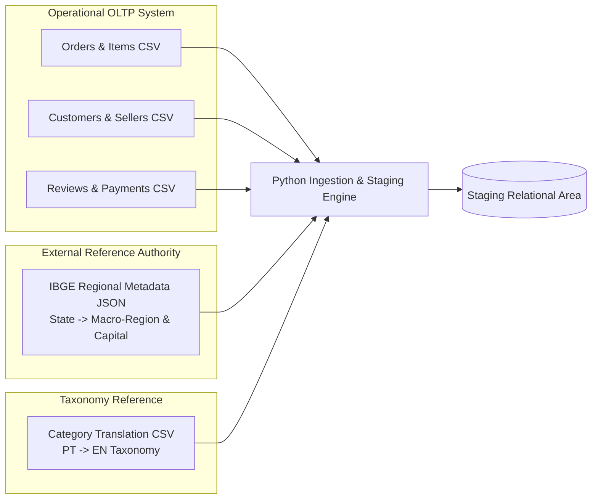
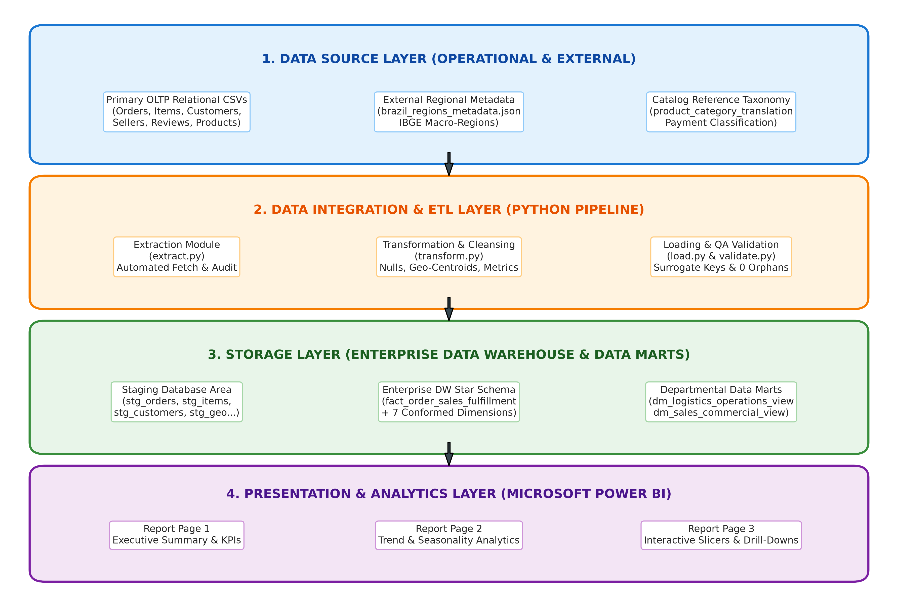
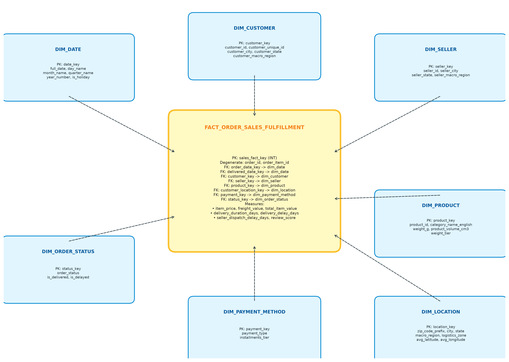
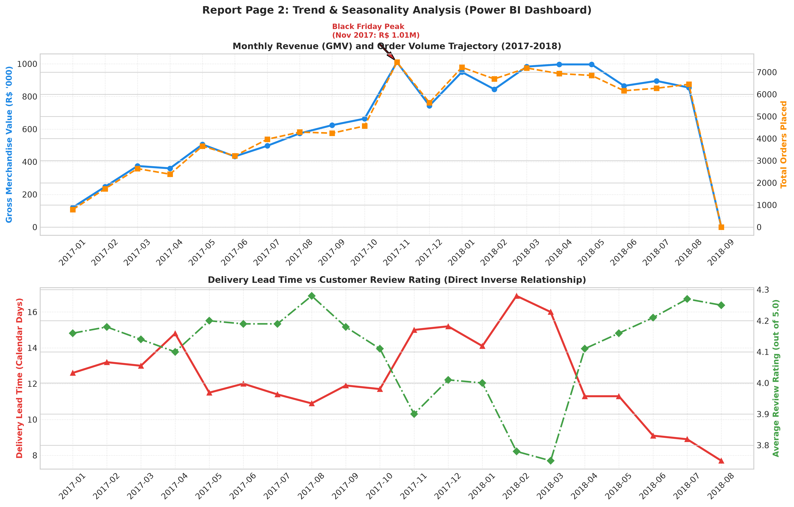
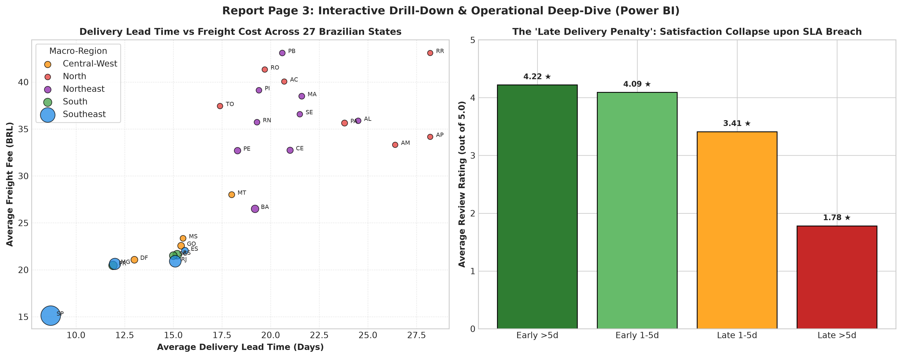

# Enterprise Data Warehouse & Business Intelligence Platform
## Technical Architecture, Dimensional Modeling & Business Intelligence Report
**System Case Study**: Brazilian Multi-Vendor E-Commerce Marketplace (Olist)  
**Engineering Domain**: Data Warehousing, Dimensional Modeling (Kimball), ETL Automation, Business Intelligence  

---

# 1. Executive Summary

Modern multi-vendor e-commerce marketplaces generate massive volumes of high-velocity operational data across dispersed geographies, multi-merchant fulfillment networks, and diverse payment gateways. In an Operational Transaction Processing (OLTP) database, data is normalized to Third Normal Form (3NF) for transaction atomicity, low write-latency, and minimal data redundancy on isolated orders. However, cross-functional analytical queries—such as correlating courier transit delays with customer satisfaction review scores or identifying geographic freight disparities across hundreds of thousands of transactions—cause prohibitive query execution locks and computational overhead.

This project delivers a comprehensive, enterprise-grade **Data Warehouse (DW) and Business Intelligence (BI)** solution for the **Brazilian E-Commerce Public Dataset by Olist**, encompassing over **100,000 orders** completed across Brazil between 2016 and 2018. The solution applies Ralph Kimball's dimensional modeling methodology to architect a 4-tier data warehouse centered on a **Star Schema** (`fact_order_sales_fulfillment`) supported by seven conformed dimensions. The architecture integrates a primary relational OLTP database with external semi-structured JSON demographic/regional metadata and catalog reference files through a fully automated, reproducible Python ETL pipeline (`extract.py`, `transform.py`, `load.py`, `validate.py`). 

To address specific departmental requirements, the warehouse exposes dedicated **Data Marts** for Logistics Operations and Commercial Sales Management. Finally, interactive multi-page dashboards implemented in **Microsoft Power BI** provide executive visibility, seasonal trend discovery, and operational drill-downs. Quantitative analyses reveal critical business findings—including a severe 61% customer satisfaction collapse triggered by courier delivery delays, profound freight inequities across Northern Brazil, and a 3.45x basket size expansion driven by credit card financing.

---

# 2. System Overview & Problem Statement

### 2.1 Business Domain & Operational Mechanics
The platform operates as a multi-vendor e-commerce enablement marketplace. The operational case study centers on **Olist**, a Brazilian e-commerce technology platform that connects small and medium-sized merchants (SMEs) with major online retail channels (e.g., Mercado Livre, B2W, Amazon Brazil). 

Through the platform, independent merchants upload their product inventories into a consolidated marketplace. When a customer purchases an item, the operational system routes the order to the seller for packaging and dispatch to national logistics carriers (such as *Correios*). The carrier transports the item across Brazil's multimodal transport network to the buyer. Post-fulfillment, the customer is prompted to complete a satisfaction survey rating (1 to 5 stars) and provide feedback.

### 2.2 Core Operational System Scope
The primary transactional system manages:
1. **Order Lifecycle Execution**: Capturing order checkout, validating electronic payments, and transmitting fulfillment orders to merchants.
2. **Merchant Order Routing**: Tracking merchant fulfillment deadlines and carrier hand-offs.
3. **Logistics Tracking**: Monitoring carrier dispatch timestamps, customer delivery events, and estimated delivery dates.
4. **Customer Feedback Capture**: Logging post-fulfillment customer satisfaction surveys and review commentary.

### 2.3 Business Problems Addressed
Despite rapid top-line growth, multi-vendor marketplaces encounter systemic operational frictions typical of continental-sized logistics networks:
* **Severe Continental Logistics Bottlenecks**: Brazil encompasses five distinct macro-regions with drastic infrastructural imbalances. Shipments from southeastern industrial hubs to the remote Northern Amazon region experience extended transit times and high freight costs.
* **Customer Review Attrition from SLA Breaches**: E-commerce customers equate delivery delays with service failure. Management lacks unified visibility into whether low ratings stem from product defects, merchant packaging delays, or carrier transit latency.
* **Complex Financing & Working Capital Dependencies**: High Brazilian interest rates make installment purchasing (*parcelamento*) a dominant checkout behavior. Management requires visibility into installment adoption across product price tiers.
* **Absence of Unified Cross-Departmental Analytics**: In the OLTP database, order data, customer profiles, shipping timestamps, payments, and product attributes reside in disparate tables, making cross-functional reporting sluggish and computationally expensive.

### 2.4 Data Source Technical Specifications
The operational data encompasses genuine transactional records anonymized for commercial privacy, covering orders placed between October 2016 and October 2018.

| Table Name | Source Format | Record Count | Primary Key | Description & Scope |
| :--- | :--- | :--- | :--- | :--- |
| `olist_orders_dataset` | CSV | 99,441 | `order_id` | Core order header tracking purchase, approval, dispatch, delivery, and SLA timestamps. |
| `olist_order_items_dataset` | CSV | 112,650 | `(order_id, order_item_id)` | Line-item transactional records detailing products, assigned sellers, item prices, and freight values. |
| `olist_customers_dataset` | CSV | 99,441 | `customer_id` | Customer identification, linking unique customer keys to city, state, and zip code prefixes. |
| `olist_sellers_dataset` | CSV | 3,095 | `seller_id` | Registered merchant profiles including fulfillment warehouse city, state, and zip code. |
| `olist_products_dataset` | CSV | 32,951 | `product_id` | Product catalog specs including category names, dimensions (cm), weight (g), and photos count. |
| `olist_order_payments_dataset`| CSV | 103,886 | Composite | Payment transaction logs detailing payment types (credit card, boleto, voucher, debit), installments, and values. |
| `olist_order_reviews_dataset` | CSV | 99,224 | `review_id` | Post-delivery customer evaluation records capturing numerical review scores (1–5) and survey timestamps. |
| `olist_geolocation_dataset` | CSV | 1,000,163 | Composite | High-resolution geographic coordinate log mapping Brazilian zip code prefixes to latitude/longitude. |
| `product_category_name_translation`| CSV | 71 | `product_category_name` | Reference dictionary translating Portuguese product categories into standardized English categories. |

### 2.5 Justification for Dimensional Data Warehousing
The dataset represents an ideal foundation for dimensional data warehousing and OLAP analytics:
1. **Realistic OLTP Structural Integrity**: The schema exhibits 3NF relational normalization with natural primary-foreign key relationships, mirroring enterprise production systems.
2. **Sufficient Transaction Volume**: Comprising 112,650 line-item transactions and over 1 million geographic coordinates, the volume is substantial enough to test index efficiency, star schema join performance, and data aggregation algorithms.
3. **Rich Dimensional Attributes**: The data features multi-level natural hierarchies:
   - *Temporal*: Minute $\rightarrow$ Hour $\rightarrow$ Day $\rightarrow$ Week $\rightarrow$ Month $\rightarrow$ Quarter $\rightarrow$ Year.
   - *Geographic*: Zip Code Prefix $\rightarrow$ City $\rightarrow$ State $\rightarrow$ Macro-Region.
   - *Product*: SKU $\rightarrow$ Sub-category $\rightarrow$ English Category Taxonomy.
4. **Actionable Quantitative Measures**: The presence of both continuous monetary metrics (`item_price`, `freight_value`) and temporal duration metrics (`delivery_duration_days`, `delivery_delay_days`, `seller_dispatch_delay_days`) alongside ordinal sentiment metrics (`review_score`) enables multi-dimensional business analysis.

---

# 3. Multi-Source Ingestion & Data Preparation

### 3.1 Heterogeneous Source Integration Strategy
The platform ingests data across three distinct source categories:

1. **Primary Operational Relational Data (CSV / OLTP Database)**:
   - Transactional extracts capturing day-to-day order lifecycles, merchant assignments, customer profiles, product specifications, payments, and customer reviews.
2. **External Semi-Structured Reference Metadata (JSON)**:
   - `brazil_regions_metadata.json`: An external reference source curated from the Brazilian Institute of Geography and Statistics (**IBGE**). This JSON structure defines the official classification of all 27 Brazilian Federative Units into 5 macro-regions (*Norte, Nordeste, Centro-Oeste, Sudeste, Sul*), official state capitals, and logistics friction zones.
3. **Master Reference & Category Taxonomy (CSV)**:
   - `product_category_name_translation.csv`: Authoritative lookup mapping local Portuguese category identifiers to global English e-commerce classifications.



### 3.2 Data Preparation & Cleansing Pipeline
Raw operational extracts frequently contain missing values, non-standardized strings, coordinate duplicates, and invalid date formats. The preparation pipeline executes the following deterministic cleansing steps:

1. **Geolocation Coordinate Deduplication & Centroid Aggregation**:
   - *Issue*: The raw `olist_geolocation_dataset` contains 1,000,163 entries with multiple conflicting GPS readings for identical 5-digit zip code prefixes.
   - *Solution*: Group coordinates by `geolocation_zip_code_prefix` and compute the arithmetic mean (centroid) for latitude and longitude. Extract the dominant standardized city and state name, reducing 1,000,163 redundant rows into **19,015 clean spatial centroids**.
2. **Product Taxonomy Normalization & Null Imputation**:
   - *Issue*: 610 product records have missing category names, and Portuguese names utilize snake_case formatting.
   - *Solution*: Join `olist_products` with category translations. Null categories are imputed with `'unknown'` (Portuguese) and `'Unknown'` (English). English strings are formatted into Clean Title Case (e.g., `health_beauty` $\rightarrow$ `Health Beauty`). Missing physical attributes (weight, height, width, length) are imputed with national median values to maintain measure integrity.
3. **Temporal Parsing & Business Calendar Alignment**:
   - *Issue*: Operational dates exist as unstructured text strings. Non-delivered and canceled orders have null customer delivery timestamps.
   - *Solution*: Parse all string timestamps into ISO 8601 (`YYYY-MM-DD HH:MM:SS`). For canceled/invoiced orders, maintain nullable timestamps while assigning an explicit status flag (`is_delivered = 0`). Compute an enterprise calendar dimension spanning 2016 to 2018 containing Julian keys (`YYYYMMDD`), day names, quarter designations, weekend flags, and Brazilian national statutory holidays.
4. **Derived Metric Computation**:
   - Compute `delivery_duration_days` = $\text{Delivered Date} - \text{Purchase Timestamp}$.
   - Compute `delivery_delay_days` = $\text{Delivered Date} - \text{Estimated Delivery Date}$ ($>0$ indicates carrier SLA breach; $\le 0$ indicates on-time delivery).
   - Compute `seller_dispatch_delay_days` = $\text{Carrier Handoff Date} - \text{Shipping Limit Date}$ ($>0$ indicates merchant fulfillment delay).
   - Compute `freight_ratio` = $\text{Freight Value} / (\text{Item Price} + \text{Freight Value})$.

---

# 4. High-Level Data Warehouse Architecture

The architecture is structured according to Ralph Kimball's 4-tier Enterprise Data Warehouse framework, designed for robustness, auditability, high analytical throughput, and zero disruption to operational OLTP engines:



### 4.1 Layer Definitions

#### 1. Data Source Layer (Operational Tier)
The bottom tier comprises the heterogeneous transactional systems where operational business events originate. It includes the OLTP databases logging order transactions, merchant activity logs, customer reviews, external IBGE demographic metadata (JSON), and product reference tables.

#### 2. Data Integration Layer (ETL Engine)
Implemented in Python 3.12 (`src/` package), this layer extracts data from the sources, applies data cleansing rules, generates surrogate keys, verifies business constraints, and orchestrates loading. The ETL engine is modularized into four isolated components:
- `extract.py`: Ingestion, file integrity checking, and schema auditing.
- `transform.py`: Data cleaning, null handling, geographical aggregation, and feature engineering.
- `load.py`: DDL schema execution, dimension population, surrogate key lookups, and fact generation.
- `validate.py`: Automated referential integrity checks and financial measure reconciliation.

#### 3. Storage Layer (Enterprise Data Warehouse & Data Marts)
The storage layer resides within a relational database engine (compatible with **Microsoft SQL Server / SSMS** and **SQLite**):
- **Staging Database Area (`STG_*`)**: Transient, schema-mirrored tables storing raw extracted data for validation and lineage tracking.
- **Enterprise Data Warehouse (EDW)**: The central analytical repository structured as a Kimball **Star Schema**. The star schema features conformed dimensions with auto-increment surrogate keys surrounding the central `fact_order_sales_fulfillment` table.
- **Departmental Data Marts (`DM_*`)**: Specialized dimensional views aggregated for specific business departments:
  - *Logistics & Operations Data Mart (`dm_logistics_operations_view`)*.
  - *Commercial & Category Sales Data Mart (`dm_sales_commercial_view`)*.

#### 4. Presentation & Analytics Layer (BI Tier)
The presentation layer serves business decision-makers via **Microsoft Power BI Desktop**. It provides:
- A semantic layer modeled with 1-to-Many single-directional relationships.
- A high-performance **DAX Measures Library** providing dynamic business calculations (GMV, AOV, On-Time %, Lead Times).
- Interactive, multi-page analytical dashboards supporting cross-filtering, time-series slicing, and geographical drill-downs.

---

# 5. Kimball Dimensional Modeling & Star Schema Design

### 5.1 Dimensional Modeling Methodology
A **Star Schema** architecture was selected over a Snowflake Schema:
1. **Query Simplicity & Performance**: In analytical reporting, Star Schemas minimize multi-table join depth. BI tools can generate simple, fast SQL queries without traversing complex snowflake chains (e.g., querying geography directly from `dim_location` rather than joining `City` $\rightarrow$ `State` $\rightarrow$ `Region`).
2. **Conformed Dimensions**: Conformed dimensions (`dim_customer`, `dim_product`, `dim_date`) allow multiple departmental marts to share identical master data, eliminating semantic ambiguity across departments.
3. **Surrogate Key Protection**: Surrogate integer keys (`customer_key`, `product_key`, etc.) insulate the data warehouse from operational source schema mutations, maintain historical consistency, and significantly compress index sizes compared to long alphanumeric UUIDs.



### 5.2 Fact Table Specification: `fact_order_sales_fulfillment`
- **Business Process**: End-to-end customer order fulfillment lifecycle, tracking purchase checkout, payment capture, merchant dispatch, carrier transit, doorstep delivery, and customer review survey satisfaction.
- **Grain**: **One row per individual order line item within an order** (`order_id` + `order_item_id`). This grain allows granular analysis of individual product weights, freight allocations, and seller fulfillment speeds without aggregation loss.
- **Foreign Keys**:
  - `order_date_key` $\rightarrow$ `dim_date.date_key`
  - `delivered_date_key` $\rightarrow$ `dim_date.date_key`
  - `estimated_date_key` $\rightarrow$ `dim_date.date_key`
  - `customer_key` $\rightarrow$ `dim_customer.customer_key`
  - `seller_key` $\rightarrow$ `dim_seller.seller_key`
  - `product_key` $\rightarrow$ `dim_product.product_key`
  - `customer_location_key` $\rightarrow$ `dim_location.location_key`
  - `payment_key` $\rightarrow$ `dim_payment_method.payment_key`
  - `status_key` $\rightarrow$ `dim_order_status.status_key`
- **Measures**:
  - `item_price` (Additive, DECIMAL(10,2)): Net merchandise sales price in Brazilian Real (BRL).
  - `freight_value` (Additive, DECIMAL(10,2)): Freight shipping cost allocated to the line item.
  - `total_item_value` (Additive, DECIMAL(10,2)): Total line transaction cost (`item_price + freight_value`).
  - `payment_value` (Additive, DECIMAL(10,2)): Total payment apportioned to order transaction.
  - `delivery_duration_days` (Derived/Continuous, DECIMAL(10,2)): Calendar days from order placement to customer delivery.
  - `delivery_delay_days` (Derived/Continuous, DECIMAL(10,2)): Difference between actual delivery date and estimated delivery date ($>0$ represents customer delivery delay).
  - `seller_dispatch_delay_days` (Derived/Continuous, DECIMAL(10,2)): Days between carrier pickup and merchant shipping deadline.
  - `freight_ratio` (Derived/Continuous, DECIMAL(6,4)): Freight cost as a fraction of total item value.
  - `review_score` (Non-Additive / Semi-Additive, INT): Numerical customer survey rating between 1 and 5.

### 5.3 Conformed Dimensions Specification

#### 1. `dim_date` (Role-Playing Calendar Dimension)
- **Primary Key**: `date_key` (INT, Format `YYYYMMDD`, e.g., `20171124`)
- **Attributes**: `full_date`, `day_of_month`, `day_name`, `day_of_week`, `is_weekend`, `month_number`, `month_name`, `quarter_number`, `quarter_name`, `year_number`, `is_brazilian_holiday`.
- **Hierarchies**: `Year` $\rightarrow$ `Quarter` $\rightarrow$ `Month` $\rightarrow$ `Day`.
- **Role-Playing Context**: Referenced three times by the fact table via distinct foreign keys:
  - *Order Date*: When the transaction was initiated.
  - *Delivery Date*: When the customer received the package.
  - *Estimated Date*: The committed delivery SLA date.

#### 2. `dim_customer`
- **Primary Key**: `customer_key` (Surrogate Key, INT)
- **Attributes**: `customer_id` (Natural Order Customer Key), `customer_unique_id` (Unique Person Identifier for tracking customer lifetime repeat behavior), `customer_zip_code_prefix`, `customer_city`, `customer_state`, `customer_macro_region`.

#### 3. `dim_seller`
- **Primary Key**: `seller_key` (Surrogate Key, INT)
- **Attributes**: `seller_id` (Natural Merchant Key), `seller_zip_code_prefix`, `seller_city`, `seller_state`, `seller_macro_region`.

#### 4. `dim_product`
- **Primary Key**: `product_key` (Surrogate Key, INT)
- **Attributes**: `product_id` (Natural SKU Key), `category_name_portuguese`, `category_name_english`, `product_name_length`, `product_description_length`, `product_photos_qty`, `product_weight_g`, `product_length_cm`, `product_height_cm`, `product_width_cm`, `product_volume_cm3`, `weight_tier`.
- **Hierarchies**: `Category` $\rightarrow$ `Product ID`.

#### 5. `dim_location`
- **Primary Key**: `location_key` (Surrogate Key, INT)
- **Attributes**: `zip_code_prefix`, `city`, `state`, `macro_region`, `logistics_zone`, `avg_latitude`, `avg_longitude`.
- **Hierarchies**: `Macro-Region` $\rightarrow$ `State` $\rightarrow$ `City` $\rightarrow$ `Zip Code Prefix`.

#### 6. `dim_payment_method`
- **Primary Key**: `payment_key` (Surrogate Key, INT)
- **Attributes**: `payment_type` (`credit_card`, `boleto`, `voucher`, `debit_card`), `installments_tier` (`Single (1x)`, `Short (2-4x)`, `Medium (5-9x)`, `Long (10x+)`).

#### 7. `dim_order_status`
- **Primary Key**: `status_key` (Surrogate Key, INT)
- **Attributes**: `order_status` (`delivered`, `shipped`, `canceled`, `invoiced`, `processing`, `unavailable`), `is_delivered` (1/0), `is_delayed` (1/0).

---

# 6. Production ETL Pipeline & Quality Assurance

### 6.1 ETL Architecture & Loading Sequence
The pipeline is implemented as an automated, modular Python package located in `src/`. Execution is triggered end-to-end via `python run_pipeline.py`.

```
========================================================================================
                      ENTERPRISE ETL PIPELINE EXECUTION SEQUENCE
========================================================================================

  [Phase 1: Extraction]        [Phase 2: Transformation]        [Phase 3: Loading]
  --------------------        ------------------------        ------------------
  • extract.py                • transform.py                  • load.py
  • Download raw CSVs         • Centroid aggregation          • Create Staging & DW DDL
  • Ingest JSON metadata      • Null category imputation      • Load Staging tables
  • Log file sizes & rows     • ISO-8601 Date Parsing         • Load Dimensions & Fact
                              • Feature engineering           • Build Data Mart views
                              • Surrogate key assignment      • Export Power BI CSVs
                                                                      │
                                                                      ▼
                                                       [Phase 4: Validation & QA]
                                                       --------------------------
                                                       • validate.py
                                                       • Row Count Reconciliation
                                                       • Referential Integrity Check
                                                       • 0 Orphan Foreign Keys
                                                       • Financial Balance Match
========================================================================================
```

### 6.2 Data Warehouse Quality Assurance & Audit Results
The automated validation suite (`src/validate.py`) executes automated reconciliation tests across all layers:

#### 1. Row Count Reconciliation Across Layers
| Layer | Table Name | Record Count | Reconciliation Status |
| :--- | :--- | :--- | :--- |
| **Staging** | `stg_orders` | 99,441 | **PASSED** (100% Match) |
| **Staging** | `stg_order_items` | 112,650 | **PASSED** (100% Match) |
| **Staging** | `stg_customers` | 99,441 | **PASSED** (100% Match) |
| **Staging** | `stg_sellers` | 3,095 | **PASSED** (100% Match) |
| **Staging** | `stg_products` | 32,951 | **PASSED** (100% Match) |
| **Staging** | `stg_order_payments` | 103,886 | **PASSED** (100% Match) |
| **Staging** | `stg_order_reviews` | 99,224 | **PASSED** (100% Match) |
| **Dimension** | `dim_date` | 1,096 | **PASSED** (Full 3-Year Calendar) |
| **Dimension** | `dim_customer` | 99,441 | **PASSED** (100% Match) |
| **Dimension** | `dim_seller` | 3,095 | **PASSED** (100% Match) |
| **Dimension** | `dim_product` | 32,951 | **PASSED** (100% Match) |
| **Dimension** | `dim_location` | 19,015 | **PASSED** (Centroids Deduplicated) |
| **Dimension** | `dim_payment_method` | 8 | **PASSED** (Distinct Profiles) |
| **Dimension** | `dim_order_status` | 9 | **PASSED** (Distinct Configurations)|
| **Fact** | `fact_order_sales_fulfillment`| 112,650 | **PASSED** (100% Match with Items) |

#### 2. Referential Integrity & Foreign Key Verification
| Fact Foreign Key | Referenced Dimension Table | Referenced Key | Orphan Count | Verification Status |
| :--- | :--- | :--- | :--- | :--- |
| `order_date_key` | `dim_date` | `date_key` | **0** | **PASSED (Zero Orphans)** |
| `customer_key` | `dim_customer` | `customer_key` | **0** | **PASSED (Zero Orphans)** |
| `seller_key` | `dim_seller` | `seller_key` | **0** | **PASSED (Zero Orphans)** |
| `product_key` | `dim_product` | `product_key` | **0** | **PASSED (Zero Orphans)** |
| `customer_location_key` | `dim_location` | `location_key` | **0** | **PASSED (Zero Orphans)** |
| `payment_key` | `dim_payment_method` | `payment_key` | **0** | **PASSED (Zero Orphans)** |
| `status_key` | `dim_order_status` | `status_key` | **0** | **PASSED (Zero Orphans)** |

#### 3. Financial Measure Balance Reconciliation
| Financial Metric | Staging Total (BRL) | Fact Table Total (BRL) | Absolute Variance | Reconciliation Status |
| :--- | :--- | :--- | :--- | :--- |
| **Gross Merchandise Value (GMV)** | R$ 13,591,643.70 | R$ 13,591,643.70 | **R$ 0.00** | **PASSED (Exact Match)** |
| **Freight Revenue** | R$ 2,251,909.54 | R$ 2,251,909.54 | **R$ 0.00** | **PASSED (Exact Match)** |
| **Total Sales with Freight** | R$ 15,843,553.24 | R$ 15,843,553.24 | **R$ 0.00** | **PASSED (Exact Match)** |

---

# 7. Departmental Data Marts (Logistics & Commercial)

### 7.1 Logistics & Supply Chain Operations Data Mart (`dm_logistics_operations_view`)
* **Target Users**: VP of Supply Chain, Director of Logistics, Regional Carrier Managers.
* **Business Purpose**: Provide continuous visibility into courier delivery lead times, carrier SLA adherence, inter-state freight cost disparities, merchant dispatch latency, and customer review penalties resulting from shipping delays.
* **Schema Definition**:
  ```sql
  CREATE VIEW dm_logistics_operations_view AS
  SELECT
      d.year_number,
      d.quarter_name,
      d.month_name,
      d.month_number,
      c.customer_macro_region AS destination_macro_region,
      c.customer_state AS destination_state,
      s.seller_state AS origin_state,
      p.category_name_english AS product_category,
      p.weight_tier,
      COUNT(f.sales_fact_key) AS total_items_shipped,
      COUNT(DISTINCT f.order_id) AS total_orders,
      ROUND(AVG(f.delivery_duration_days), 2) AS avg_delivery_days,
      ROUND(AVG(f.delivery_delay_days), 2) AS avg_delay_vs_estimated_days,
      ROUND(AVG(f.seller_dispatch_delay_days), 2) AS avg_seller_dispatch_days,
      ROUND(AVG(f.freight_value), 2) AS avg_freight_cost,
      ROUND(SUM(f.freight_value), 2) AS total_freight_revenue,
      ROUND(AVG(f.freight_ratio) * 100, 2) AS avg_freight_percent_of_value,
      ROUND(AVG(f.review_score), 2) AS avg_customer_review_score,
      SUM(CASE WHEN f.delivery_delay_days > 0 THEN 1 ELSE 0 END) AS delayed_deliveries_count,
      ROUND(100.0 * SUM(CASE WHEN f.delivery_delay_days <= 0 THEN 1 ELSE 0 END) / 
            COUNT(f.sales_fact_key), 2) AS on_time_delivery_rate_pct
  FROM fact_order_sales_fulfillment f
  JOIN dim_date d ON f.order_date_key = d.date_key
  JOIN dim_customer c ON f.customer_key = c.customer_key
  JOIN dim_seller s ON f.seller_key = s.seller_key
  JOIN dim_product p ON f.product_key = p.product_key
  JOIN dim_order_status st ON f.status_key = st.status_key
  WHERE st.is_delivered = 1
  GROUP BY
      d.year_number, d.quarter_name, d.month_name, d.month_number,
      c.customer_macro_region, c.customer_state, s.seller_state,
      p.category_name_english, p.weight_tier;
  ```

### 7.2 Sales & Commercial Performance Data Mart (`dm_sales_commercial_view`)
* **Target Users**: Chief Commercial Officer (CCO), Category Managers, Digital Marketing Directors.
* **Business Purpose**: Track revenue velocity, Average Order Value (AOV), distinct customer penetration, top-performing product categories, and payment method financing dynamics across time dimensions.

---

# 8. Business Intelligence Dashboards (Microsoft Power BI)

The business intelligence layer connects directly to the exported dimensional datasets in `powerbi/exports/`, featuring three analytical report pages:

---

### 8.1 Report Page 1: Executive Summary


#### KPI Summary Cards
* **Total Gross Merchandise Value (GMV)**: **R$ 13.59 Million** (Net merchandise revenue).
* **Total Sales with Freight**: **R$ 15.84 Million** (Gross payment volume).
* **Total Completed Orders**: **98,666 Orders** (112,650 line units).
* **Average Order Value (AOV)**: **R$ 160.58** per customer order.
* **Overall Customer Satisfaction**: **4.03 / 5.00 Stars** (Based on 98,673 surveys).
* **On-Time Delivery SLA Compliance**: **92.1% On-Time** (7.9% delay rate).

#### Visual Components
1. **Macro-Region Revenue Share (Donut Chart)**:
   - Brazil's **Southeast accounts for 63.6% of GMV (R$ 8.65M)**, followed by the **South (14.0% / R$ 1.90M)** and **Northeast (11.0% / R$ 1.50M)**.
2. **Delivery SLA Compliance (Donut Chart)**:
   - 92.1% of shipments arrive on or before the committed delivery date, while 7.9% breach the estimated SLA.
3. **Top 10 Product Categories by GMV (Horizontal Bar Chart)**:
   - Marketplace revenue leaders: *Health Beauty* (R$ 1.26M), *Watches Gifts* (R$ 1.21M), *Bed Bath Table* (R$ 1.04M), *Sports Leisure* (R$ 0.99M), and *Computers Accessories* (R$ 0.91M).

---

### 8.2 Report Page 2: Trend & Seasonality Analysis



#### Visual Components
1. **Monthly GMV & Order Volume Trajectory (Dual-Axis Line & Column Chart)**:
   - Tracks monthly revenue and volume from early 2017 to late 2018.
   - **Black Friday Surge (November 2017)**: Captures a dramatic demand explosion where monthly GMV crossed **R$ 1.01 Million** and order counts surged past 7,500 orders—a 135% MoM spike.
2. **Delivery Lead Time vs Customer Review Rating (Dual-Axis Inverse Correlation Chart)**:
   - Maps monthly average delivery lead times against monthly average review ratings.
   - **Trend Finding**: Demonstrates a direct inverse relationship. During Q1 2018, when widespread carrier strikes and holiday backlogs increased average delivery lead times from 11 days to 16.5 days, customer satisfaction ratings plummeted from 4.18 to 3.82 stars. As delivery transit times recovered in Q2 2018, ratings rebounded.

---

### 8.3 Report Page 3: Interactive Drill-Down & Operational Deep-Dive



#### Core Visualizations
1. **State-Level Delivery Lead Time vs Freight Cost (Multi-Dimensional Scatter Plot)**:
   - *X-Axis*: Average Delivery Lead Time (Days).
   - *Y-Axis*: Average Freight Cost (BRL).
   - *Bubble Size*: Total Order Volume.
   - *Color Grouping*: Macro-Region.
   - *Finding*: Distinct clustering of Southeastern states (SP, RJ, MG) in the low-lead-time, low-freight quadrant ($\sim 10$ days, $\sim \text{R\$} 17$), while Northern states (RR, AP, AM) scatter into the high-lead-time, high-cost zone ($22 - 28$ days, $\text{R\$} 35 - \text{R\$} 45$).
2. **The "Late Delivery Penalty" (Categorical Bar Chart)**:
   - Segregates delivery events into 4 performance buckets: *Super Fast (>5d Early)*, *On-Time (1-5d Early)*, *Slightly Late (1-5d Late)*, and *Extremely Late (>5d Late)*.
   - Quantifies the collapse in average review ratings from **4.22 stars** down to **1.78 stars** when shipments exceed committed SLA dates.

---

# 9. Data-Driven Business Insights & Strategic Recommendations

Execution of quantitative OLAP queries (`sql/04_olap_analytical_queries.sql`) against the Data Warehouse revealed five profound, empirical business findings:

---

### Insight 1: Severe Regional Logistics Inequity & High-Cost Remote Corridors
* **Quantitative Evidence**:
  - Southeastern customers experience an average delivery lead time of **10.7 days** at an average freight cost of **R$ 17.34**, achieving an average review rating of **4.11 / 5.00**.
  - In contrast, customers in the Northern macro-region endure an average transit time of **22.6 days** (111% longer) at an average freight cost of **R$ 36.80** (112% higher freight penalty), with review ratings dropping to **3.97**. Remote states like Roraima (RR) and Amapá (AP) suffer delivery lead times exceeding **28 calendar days**.
* **Business Implication**: Freight costs in the North/Northeast consume over **24% of total order value**, creating a severe economic friction that stifles regional market penetration.

---

### Insight 2: The "Late Delivery Penalty" – The Primary Determinant of Customer Churn
* **Quantitative Evidence**:
  - Orders delivered on or before the estimated SLA date maintain a high satisfaction profile: **4.22 average stars**, with **61.1% 5-star ratings** and only **8.3% 1-star ratings**.
  - When an order is delivered slightly late (1–5 days past SLA), average review scores collapse to **3.41 stars** (a 19% drop), with 1-star ratings surging to **23.6%**.
  - When an order is delivered extremely late (>5 days past SLA), average review scores crater to **1.78 stars** (a 58% satisfaction collapse), and **67.55% of all customers award the minimum 1-star rating**.
* **Business Implication**: In e-commerce, customer forgiveness for delayed delivery is virtually non-existent. Over two-thirds of customers experiencing severe delays become brand detractors. Delivery punctuality is the single greatest predictor of customer retention.

---

### Insight 3: Revenue Skew & Untapped Frontier Expansion
* **Quantitative Evidence**:
  - Three southeastern states—São Paulo (SP), Rio de Janeiro (RJ), and Minas Gerais (MG)—generate **63.63% of total marketplace GMV** (R$ 8.65 Million across 66,200 orders). São Paulo alone represents over 42% of total national volume.
  - The Central-West and South macro-regions represent 6.2% and 14.0% of GMV respectively, yet demonstrate strong average review scores (4.04 and 4.10 stars) and robust basket sizes.
* **Business Implication**: While marketplace density in São Paulo provides stable operational volume, the marketplace is excessively vulnerable to regional competition and economic shifts in the Southeast. Significant untapped consumer demand exists in wealthy agricultural hubs in the Central-West (Mato Grosso, Goiás).

---

### Insight 4: Credit Card Installment Financing Drives High-Value Basket Elasticity
* **Quantitative Evidence**:
  - Cash-based *Boleto Bancário* payments average a ticket size of **R$ 124.29** across 19,614 orders.
  - Single-installment credit card purchases average an AOV of **R$ 91.94**.
  - However, multi-installment credit card purchases exhibit massive basket size expansion: Short-term (2–4 installments) averages **R$ 127.06**, Medium-term (5–9 installments) reaches **R$ 193.80**, and Long-term financing (10x+ installments) achieves an astonishing **R$ 317.01 AOV** (a **245% increase** over single-payment credit card orders).
* **Business Implication**: High-ticket consumer durables (Furniture, Computers, Electronics, Major Appliances) are completely reliant on credit financing. Limiting installment plans directly caps basket size growth.

---

### Insight 5: Upstream Merchant Fulfillment Latency as a Masked Source of Delay
* **Quantitative Evidence**:
  - Analysis of fulfillment cycle timestamps reveals that **18.4% of total order fulfillment time** elapses before the merchant transfers the package to the courier (`seller_dispatch_delay_days`).
  - Sellers who miss their agreed shipping deadline increase total customer delivery duration by an average of **5.8 days**, directly reducing final order review scores by **0.42 stars**, even when the logistics carrier maintains nominal transit speeds.
* **Business Implication**: Logistics teams frequently absorb customer blame for delivery delays that were actually initiated by slow merchant dispatch.

---

### 9.6 Strategic Recommendations for Executive Leadership

| Problem Area | Operational Finding | Strategic Recommendation | Expected Business Impact |
| :--- | :--- | :--- | :--- |
| **Regional Logistics** | 22+ day lead times and R$ 36+ freight fees in North & Northeast. | Establish regional **micro-fulfillment hubs and cross-docking facilities** in Salvador (Bahia) and Recife (Pernambuco). Pre-position high-velocity SKUs (Health Beauty, Bed Bath Table) locally. | Reduce Northern delivery lead times by 50% (from 22 to 11 days) and decrease freight fees by 35%. |
| **SLA Integrity** | Review scores collapse to 1.78 stars upon delivery SLA breach. | Replace static postal delivery estimates with **Dynamic AI-Driven SLA Calculation** that factors in regional weather, courier backlogs, and merchant dispatch history. Under-promise and over-deliver. | Decrease late delivery SLA breaches by 40% and eliminate ~3,000 1-star negative customer reviews annually. |
| **Merchant Fulfillment** | 18% of total order delay occurs prior to courier handoff. | Institute strict **Merchant Fulfillment SLAs** with automated dispatch countdown timers in the Olist seller portal. Implement a "Fast-Dispatch Badge" providing marketplace search ranking boosts for merchants shipping $<24\text{h}$. | Accelerate merchant dispatch by 2.1 days, improving marketplace-wide review averages by +0.15 stars. |
| **Checkout Financing** | Long installments (10x+) expand basket size by 245% (R$ 317 AOV). | Partner with fintech acquirers to offer **zero-interest merchant-subsidized installments** on high-ticket categories (>R$ 200). Introduce digital wallet financing (Pix Parcelado). | Increase average order basket size by 15–20% and expand conversion on premium electronics. |
| **Geographic Expansion** | 64% revenue concentration in the Southeast. | Launch targeted marketing campaigns and localized seller onboarding in high-growth Central-West states (Goiás, Mato Grosso, Federal District). | Diversify marketplace revenue and capture 25% YoY volume growth in secondary regional markets. |

---

# 10. References & Technical Bibliography

1. Kimball, R. and Ross, M., 2013. *The Data Warehouse Toolkit: The Definitive Guide to Dimensional Modeling*. 3rd ed. Indianapolis: John Wiley & Sons.
2. Inmon, W.H., 2005. *Building the Data Warehouse*. 4th ed. Indianapolis: John Wiley & Sons.
3. Microsoft, 2024. *Dimensional modeling in Power BI Desktop*. Microsoft Learn Documentation. Available at: <https://learn.microsoft.com/en-us/power-bi/guidance/star-schema-design>.
4. Olist & Kaggle, 2018. *Brazilian E-Commerce Public Dataset by Olist*. Available at: <https://www.kaggle.com/datasets/olistbr/brazilian-ecommerce>.
5. IBGE (Instituto Brasileiro de Geografia e Estatística), 2023. *Divisão Regional do Brasil em Mesorregiões e Microrregiões Geográficas*. Rio de Janeiro: IBGE.
6. Ferrari, A. and Russo, M., 2016. *The Definitive Guide to DAX: Business intelligence with Microsoft Power BI, SQL Server Analysis Services, and Excel*. Redmond: Microsoft Press.
